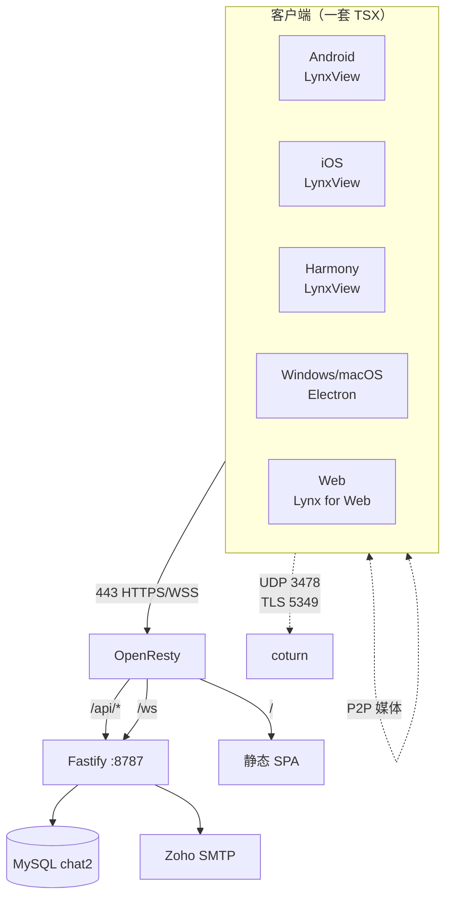

# chat — 项目方案

> 版本: v3.0（完全重构）
> 创建: 2026-10-29 北京时间
> 状态: **开发中** — 后端已跑通，前端开发中
> 旧版（PHP 单文件站点）已于 2026-10-29 废弃并清空

---

## 一、项目定位

跨平台即时通讯 App，一套 TypeScript 代码产出 **Android / iOS / HarmonyOS NEXT / Windows / macOS / Web** 六端。

核心功能：
- 文字 / 图片 / 视频 / 文件 / 语音条消息
- 1:1 私聊 + 群聊（≤200 人）
- 语音通话（P2P Mesh，≤8 人，支持锁屏后台）
- 邮箱注册 + 邮箱验证码 + 邀请码机制

---

## 二、技术选型（已确认）

| 层 | 选型 | 理由 |
|---|---|---|
| 客户端框架 | **ReactLynx**（`@lynx-js/react`） | Lynx 官方唯一一等公民，Vue 方案为个人 pre-alpha 仓库 |
| 构建 | **Rspeedy**（`@lynx-js/rspeedy`） | 官方工具链，可同时出 lynx 与 web 产物 |
| 桌面端 | **Electron** | 与客户端共用 TSX，Chromium 自带 WebRTC |
| 后端 | **Node 22 + Fastify 5** | 与前端共享 TS 类型，内存占用低（~100MB） |
| ORM | **Drizzle** | 无运行时反射，2G 服务器友好 |
| 数据库 | **MySQL 8.4**（复用现有容器） | 已运行，零额外内存 |
| 通话 | **WebRTC P2P Mesh + coturn** | 服务器零媒体转发，2C1.8G 完全够用 |
| 推送 | APNs / HMS / 小米 / OPPO / vivo / Harmony | 国内 Android 无 GMS，必须厂商通道 |
| 编译 | **GitHub Actions** | 服务器不做任何编译 |

---

## 三、架构



### 3.1 443 端口路由（已实测通过）

| 路径 | 目标 | 说明 |
|---|---|---|
| `/api/*` | Fastify | 全部 REST 接口 |
| `/ws` | Fastify | WebSocket（消息/在线/通话信令） |
| `/` | 静态文件 | SPA，history 模式回退 index.html |
| `/_internal_media/*` | 本地磁盘 | **仅内部**，由 X-Accel-Redirect 触发 |

**客户端只需记住一个域名 `chat.lkz.pub`，无需配置任何端口。**

### 3.2 语音通话架构（P2P Mesh）

```
A ──┐
B ──┼── 信令（JSON）──> 服务端 /ws（只转发，零媒体）
C ──┘
A ⟷ B ⟷ C  ← 媒体 P2P 直连（每路 Opus ~40kbps）
       ↓ 打洞失败（约 20% 网络）
    coturn 中继（只转发 UDP 包，不解码）
```

- 8 人时每端维持 7 条 PeerConnection，上行约 280kbps
- 服务器 CPU 消耗 <2%，无需升级配置
- 锁屏通话：Android 前台服务 / iOS CallKit+后台音频 / 鸿蒙 VOIP 长时任务

---

## 四、目录结构

```
/
├── apps/
│   ├── app/          ReactLynx 客户端（安卓/iOS/鸿蒙）
│   ├── web/          网页版
│   ├── desktop/      Electron（Win/macOS）
│   └── server/       Fastify 后端
├── packages/
│   └── shared/       共享类型/校验/常量
├── .github/workflows/ 六端 CI/CD
├── docs/             详细文档
└── runtime/uploads/  用户上传文件（不入库）
```

---

## 五、后端接口

### 认证
- `POST /api/auth/email-code` 发送验证码（60s/次，10次/日）
- `POST /api/auth/register` 注册（邮箱+验证码+密码+**邀请码**）
- `POST /api/auth/login` 登录
- `POST /api/auth/refresh` 刷新令牌（轮换）
- `POST /api/auth/logout` 登出
- `POST /api/auth/reset-password` 重置密码

### 用户
- `GET/PATCH /api/me` 我的资料
- `GET /api/users/:id` 他人资料
- `GET /api/users/search?q=` 搜索用户

### 邀请
- `GET /api/invites` 邀请总览
- `POST /api/invites` 生成邀请码
- `POST /api/invites/validate` 校验邀请码

### 会话
- `GET /api/conversations` 会话列表
- `GET /api/conversations/:id` 会话详情
- `POST /api/conversations/direct` 创建私聊
- `POST /api/conversations/group` 创建群聊
- `PATCH /api/conversations/:id/preferences` 置顶/免打扰
- `PATCH /api/conversations/:id/members` 成员管理

### 消息
- `GET /api/conversations/:id/messages` 历史（游标分页）
- `POST /api/conversations/:id/messages` 发送（clientId 幂等）
- `DELETE /api/messages/:id` 撤回

### 媒体
- `POST /api/media` 上传（≤200MB，内容寻址去重）
- `GET /api/media/:id` 读取（签名 URL）

### 通话
- `GET /api/ice-servers` STUN/TURN 配置（临时凭据）
- `GET /api/calls/current` 当前通话

### 推送
- `POST /api/push/register` 注册推送令牌
- `DELETE /api/push/register` 注销

---

## 六、数据模型（12 表）

`users` `email_codes` `invite_codes` `invite_usages` `refresh_tokens`
`conversations` `conversation_members` `messages` `attachments`
`call_sessions` `call_participants` `push_tokens`

关键设计：
- 主键 ULID（26 位，时间有序，不泄露业务量）
- 时间统一 bigint 毫秒时间戳
- 消息 `seq` 会话内单调递增（增量拉取 + 已读游标）
- 私聊 `directKey` 唯一索引去重
- 附件与消息解耦（先上传后绑定）

---

## 七、里程碑

| 阶段 | 内容 | 状态 |
|---|---|---|
| M1 | 后端骨架 + 认证 + 邀请 + 消息 + 上传 | ✅ 已完成并测试 |
| M2 | ReactLynx 客户端页面 | 🚧 开发中 |
| M3 | 三端原生模块（权限/录音/推送） | ⬜ |
| M4 | GitHub Actions 六端出包 | ⬜ |
| M5 | 部署上线 | ⬜ |
| M6 | 视频通话（SFU） | ⬜ 后续 |

---

## 八、已知待办

- [ ] **Zoho SMTP 密码**：已确认可用（`782094.Asdf`）
- [ ] **iOS/华为/小米/OPPO/vivo 推送凭据**：待用户申请
- [ ] **签名证书**：待用户提供（当前只能出未签名包）
- [ ] 视频通话：需 SFU + 服务器升级（4C8G）
